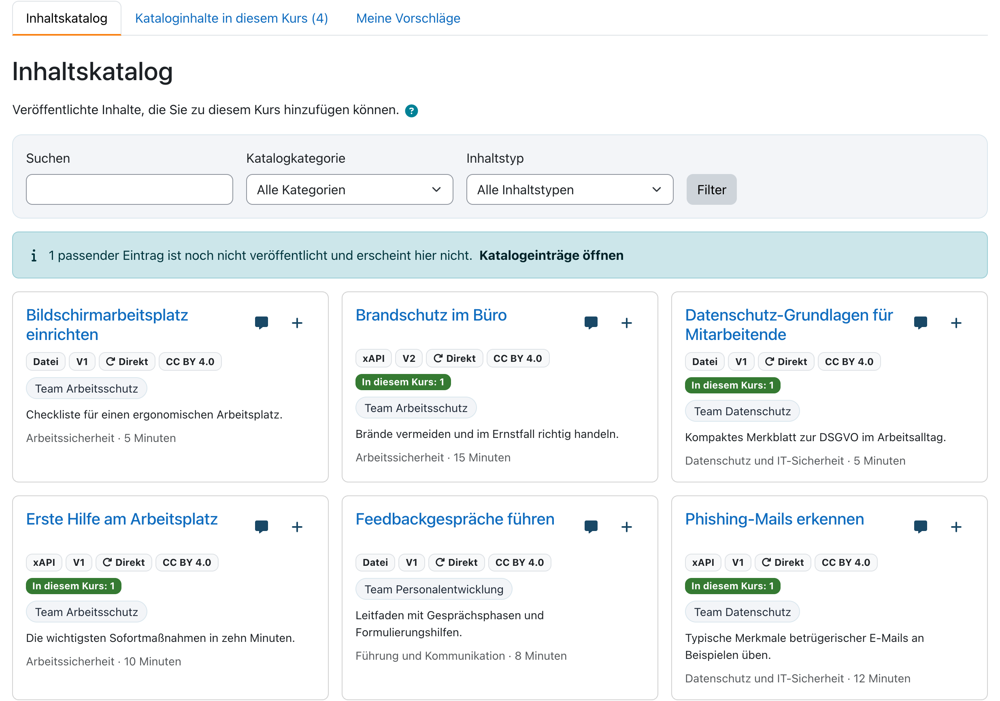
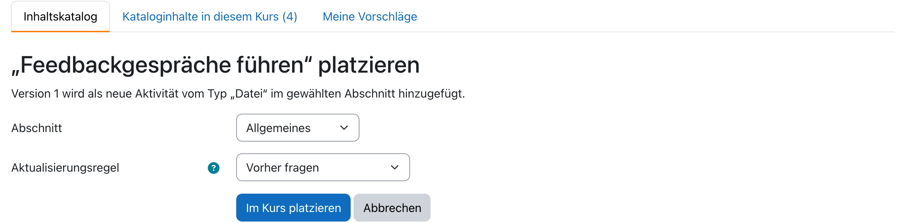
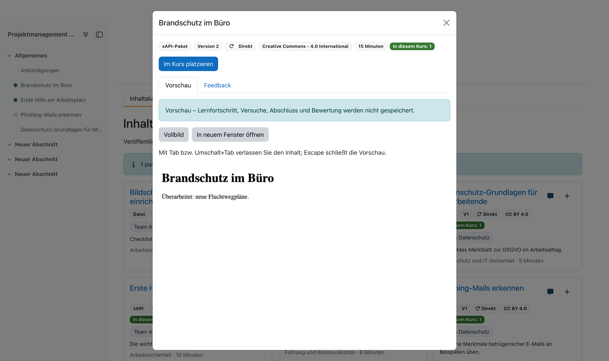
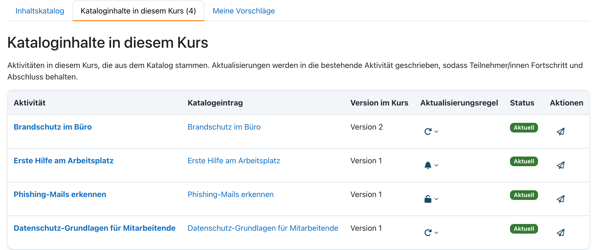
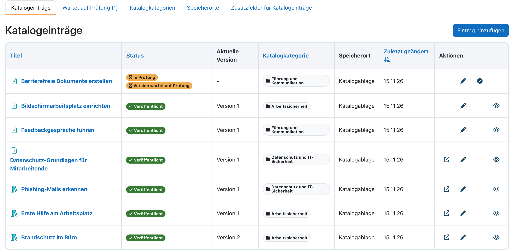
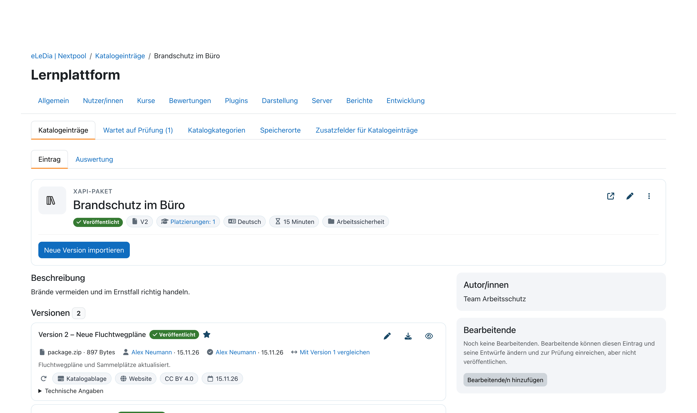
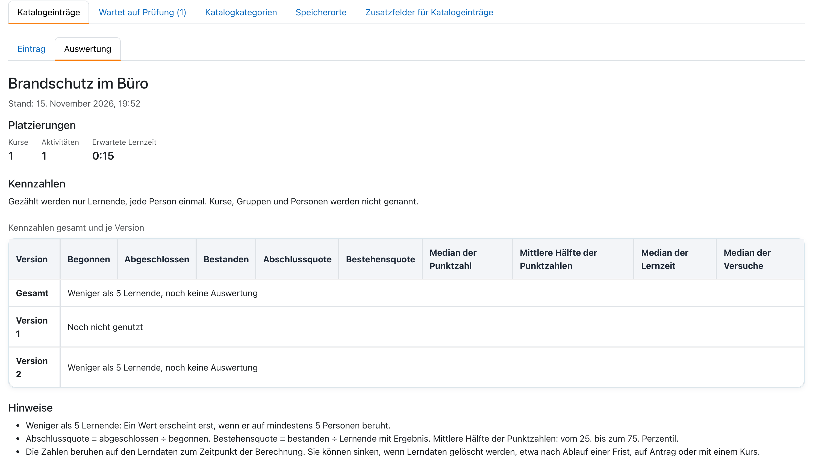
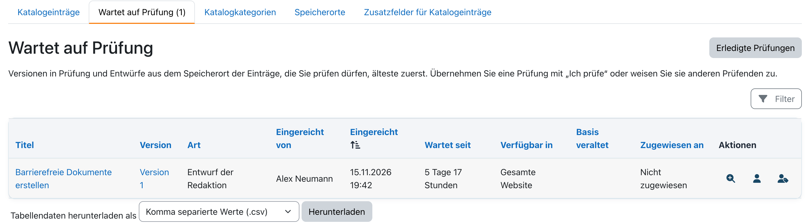

# eLeDia | Nextpool — Hilfe und Handbuch

## Überblick

eLeDia | Nextpool ist ein Katalog für Lerninhalte in Moodle. Eine Redaktion pflegt Inhalte wie Videos, Dokumente, H5P-Inhalte, Lernpakete oder Tests an einer Stelle, mit Versionen und einer Prüfung vor der Veröffentlichung. Trainer/innen holen diese Inhalte mit wenigen Klicks in ihre Kurse. Für xAPI-Pakete, Lernpakete, H5P und Dateien können sie auch eigene Inhalte im Kurs hochladen, ohne die Redaktion zu bitten. Erscheint später eine neue Version, kommt sie nach einer Regel in den Kurs, die Trainer/innen selbst wählen. Teilnehmer/innen behalten dabei Fortschritt und Abschluss, weil die neue Version in dieselbe Aktivität geschrieben wird.

Der Katalog arbeitet mit zwei weiteren Plugins zusammen: Die Aktivität **Nextpool** spielt xAPI-Pakete aus dem Katalog ab, und **eLeDia | LRS** speichert deren Lerndaten. Beide haben eigene Anleitungen.

So läuft ein Inhalt durch den Katalog:

1. Die Datei liegt in einem Speicherort, zum Beispiel in einem Ordner Ihrer Nextcloud.
2. Die Redaktion legt dazu einen Katalogeintrag an und importiert die Datei als Version 1.
3. Version und Eintrag werden geprüft und veröffentlicht.
4. Trainer/innen finden den Inhalt im Inhaltskatalog ihres Kurses und platzieren ihn. Im Kurs entsteht eine normale Moodle-Aktivität.
5. Ändert sich die Datei, entsteht eine neue Version. Nach der Veröffentlichung erhalten die Kurse sie gemäß ihrer Aktualisierungsregel.

## Zielgruppe und Einsatz

Der Katalog lohnt sich überall, wo dieselben Inhalte in vielen Kursen gebraucht werden und aktuell bleiben müssen, etwa Unterweisungen, Produktschulungen oder Grundlagenmodule. Er nutzt die Rollen und Fähigkeiten (Rechte in Moodle) Ihrer Website. Mit den Standardrollen gilt:

| Wer | Was die Person tut | Benötigte Fähigkeit | Standardmäßig bei |
|---|---|---|---|
| Trainer/innen | Inhalte aus dem Katalog im Kurs platzieren und aktualisieren; eigene Inhalte im Kurs hochladen; Rückmeldungen zu Einträgen geben | „Im Katalog stöbern“; für das Hochladen „Katalog-Inhalte als Nextpool-Aktivität platzieren“ und das Recht, die entstehende Aktivität anzulegen (bei H5P zusätzlich H5P-Inhalte bereitzustellen) | Trainer/in, Manager/in |
| Trainer/innen | Neue Versionen und neue Einträge vorschlagen | „Neue Versionen für den Katalog vorschlagen“ | Trainer/in, Manager/in |
| Katalogredaktion | Katalogeinträge anlegen und Versionen importieren | „Katalogeinträge anlegen und bearbeiten“ | Manager/in |
| Katalogredaktion (Prüfung) | Versionen und Einträge prüfen und veröffentlichen, Vorschläge entscheiden | „Katalogversionen prüfen und veröffentlichen“ | Manager/in |
| Bearbeitende eines Eintrags | Einen einzelnen Eintrag und seine Entwürfe bearbeiten und zur Prüfung einreichen, ohne zu veröffentlichen | keine eigene Fähigkeit; die Redaktion trägt sie je Eintrag ein | – |
| Admin-Team | Speicherorte und Katalogkategorien verwalten | „Speicherorte des Katalogs verwalten“, „Katalogkategorien verwalten“ | Manager/in |

Die beiden Fähigkeiten der Redaktion lassen sich auch nur für einen Kursbereich (Bereich, in dem Kurse und Unterbereiche gebündelt sind) vergeben. So kann zum Beispiel eine Fachabteilung ihre eigenen Inhalte pflegen, ohne Zugriff auf die übrigen Einträge zu haben.

## Inhalte im Kurs nutzen (Trainer/innen)

### Inhalt finden und platzieren

1. Öffnen Sie in Ihrem Kurs den Reiter „Inhaltskatalog“. Er steht in der Kursnavigation direkt nach „Teilnehmer/innen“. Alternativ wählen Sie beim Hinzufügen einer Aktivität „Inhalt aus dem Katalog“.
2. Suchen Sie den Inhalt über das Suchfeld oder filtern Sie nach Katalogkategorie, Inhaltstyp oder Tag. Sie sehen nur veröffentlichte Inhalte, die für Ihren Kurs freigegeben sind. Findet der Filter in der gewählten Kategorie nichts, in anderen aber schon, weist eine Zeile darauf hin („In anderen Kategorien gibt es Treffer.“) und bietet „Alle Kategorien“ an.
3. Klicken Sie beim gewünschten Inhalt auf „Im Kurs platzieren“.
4. Wählen Sie den Abschnitt, in dem die Aktivität erscheinen soll, und die „Aktualisierungsregel“.
5. Bestätigen Sie mit „Im Kurs platzieren“. Die Aktivität steht danach im gewählten Abschnitt.

Jeder Inhaltstyp wird zu der passenden Moodle-Aktivität:

| Inhaltstyp im Katalog | Aktivität im Kurs |
|---|---|
| Datei (Video, PDF, Dokument) | Datei |
| Textseite | Textseite |
| Link/URL | Link/URL |
| H5P | H5P |
| Lernpaket (SCORM) | Lernpaket |
| Buch | Buch |
| Test | Test |
| xAPI-Paket | Nextpool |

Die neue Aktivität verhält sich wie jede andere. Name, Beschreibung, Verfügbarkeit, Abschlussbedingungen und die übrigen Einstellungen ändern Sie wie gewohnt in den Einstellungen der Aktivität.





### Inhalt vor dem Platzieren ansehen

Klicken Sie im Inhaltskatalog auf den Titel eines Eintrags. Es öffnet sich ein Dialog mit den Reitern „Vorschau“ und „Feedback“. Im Reiter „Vorschau“ sehen Sie die aktuell veröffentlichte Version, soweit der Inhaltstyp eine Vorschau erlaubt. Über der Vorschau stehen Inhaltstyp, Version, Aktualisierungsart und Lizenz sowie der Button „Im Kurs platzieren“; unter „Über diesen Inhalt“ folgen Beschreibung, Autor/innen, Kategorie und Tags. Ist in Ihrem Kurs eine andere Version im Einsatz, nennt ein Hinweis beide, zum Beispiel „Im Kurs: Version 1. Vorschau: Version 2.“ Mit „Vollbild“ vergrößern Sie die Vorschau, mit „In neuem Fenster öffnen“ öffnen Sie sie als eigene Seite. Bei mehreren Buchkapiteln oder SCOs wählen Sie einen Abschnitt aus der Liste. Links öffnen Sie ausdrücklich über den angebotenen Link. Für nicht vorschaubare Inhalte erscheint ein Hinweis; Sie können weiterhin Rückmeldung geben oder den Eintrag platzieren.



Die Vorschau speichert keinen Lernfortschritt, keine Antworten, Punkte oder Versuche. Beim Neuladen beginnt sie neu; beim Wechsel zum Feedback oder einem anderen Bereich pausiert die Wiedergabe. Signierte Vorschau-Adressen für xAPI und SCORM laufen spätestens nach zwei Stunden ab. Öffnen Sie den Eintrag dann erneut. Eine Vorschau ist keine Kursaktivität und ersetzt nicht die Prüfung eines Pakets im vorgesehenen Kurs.

Für H5P-Vorschauen muss Moodle die aktuellen Schutzfunktionen für H5P-Inhalte und Exporte enthalten. Auf älteren Moodle-Ständen zeigt Nextpool einen Hinweis, dass die Vorschau nicht verfügbar ist. Das Admin-Team aktualisiert Moodle auf einen aktuellen Wartungsstand.

### Eigene Inhalte hochladen

Hat das Admin-Team einen Speicherort für Direkt-Uploads eingerichtet, laden Sie auch eigene Inhalte in Ihren Kurs: Wählen Sie beim Hinzufügen einer Aktivität „Nextpool“ und dann „Inhalte hochladen“. Möglich sind ein xAPI- oder SCORM-Paket, eine H5P-Datei oder eine einzelne Datei wie PDF, Video oder Dokument. Daraus entstehen die passende Aktivität und ein Katalogeintrag, der nur in Ihrem Kurs verfügbar ist. Die einzelnen Schritte beschreibt die Anleitung der Aktivität Nextpool.

Eine neue Fassung laden Sie mit „Neue Version hochladen“ im Menü der Aktivität oder mit dem Upload-Symbol in der Übersicht „Kataloginhalte in diesem Kurs“ hoch. Wählen Sie eine Datei desselben Inhaltstyps und beschreiben Sie die Änderung. Die Version ist sofort veröffentlicht. Würden dabei Lerndaten verloren gehen, bleibt die bisherige Fassung im Kurs, und die Meldung „Die Version ist veröffentlicht, wurde aber noch nicht angewendet: …“ nennt den Grund. Haben Sie den Inhalt der Aktivität im Kurs selbst geändert, zeigt die Übersicht „Inhalt im Kurs geändert“; eine neue Version ersetzt diese Änderungen. Hat die Redaktion den Eintrag für weitere Kurse freigegeben, schlagen Sie neue Versionen stattdessen vor (siehe „Neue Version oder neuen Eintrag vorschlagen“).

### Kurze Einführungstouren

Beim ersten Besuch zeigen kurze Touren die wichtigsten Aktionen: für Trainer/innen im Katalog, bei den Kataloginhalten im Kurs und beim Hinzufügen eines Inhalts; für die Redaktion in der Eintragsliste und auf der Eintragsseite. Sie können jede Tour beenden und später über „Nutzertour auf dieser Seite zurücksetzen“ im Moodle-Seitenfuß erneut starten. Alle Schritte sind auch hier im Handbuch beschrieben.

Das Admin-Team verwaltet die fünf Touren unter „Website-Administration“ > „Darstellung“ > „Nutzertouren“. Änderungen, deaktivierte oder gelöschte Touren und bereits abgeschlossene Durchläufe bleiben bei einem Nextpool-Update erhalten. Es gibt in dieser Stufe keine Tour für Teilnehmer/innen oder die LRS-Verwaltung.


### Die Aktualisierungsregel wählen

Die Aktualisierungsregel legt fest, was passiert, wenn die Redaktion eine neue Version veröffentlicht. Sie wählen sie beim Platzieren und können sie später jederzeit ändern.

- **„Automatisch aktualisieren“**: Der Kurs erhält jede neue Version, sobald sie veröffentlicht ist. Das passt für Inhalte, die immer aktuell sein sollen, zum Beispiel eine Sicherheitsunterweisung.
- **„Vorher fragen“**: Sie erhalten eine Mitteilung und auf der Kursseite den Hinweis „Für eine Aktivität aus dem Inhaltskatalog wartet eine Aktualisierung auf Sie.“ Sie entscheiden dann selbst, ob und wann Sie die Version übernehmen. Das passt, wenn ein Kurs gerade läuft und sich nicht mitten im Durchgang ändern soll.
- **„Diese Version behalten“**: Die Aktivität bleibt bei ihrer Version, bis Sie selbst eine neuere übernehmen. Das passt für Prüfungen, deren Stand nachvollziehbar bleiben muss.

Nach einer Veröffentlichung verteilt Moodle die Version im Hintergrund. Angebote und Mitteilungen erscheinen, sobald der nächste zuständige Cron-Lauf sie verarbeitet hat. Falls nach einer Veröffentlichung nichts ankommt, prüft das Admin-Team den Moodle-Cron.

In allen drei Fällen wird die neue Version in die bestehende Aktivität geschrieben. Teilnehmer/innen behalten Fortschritt, Abschluss und Bewertungen.

### Kataloginhalte im Kurs verwalten

Im Inhaltskatalog wechseln Sie über den Reiter „Kataloginhalte in diesem Kurs“ zur Übersicht aller Aktivitäten aus dem Katalog. Für jede Aktivität sehen Sie die eingesetzte Version und die Aktualisierungsregel, die Sie hier auch ändern. Öffnen Sie dafür das Symbol-Menü der Regel und wählen Sie eine der drei Regeln. Die Auswahl wird gespeichert und bestätigt; ohne JavaScript wählen Sie die Regel im Auswahlfeld und klicken auf „Änderungen speichern“. Das Symbol für einen Versionsvorschlag steht in der Aktionsspalte. Wartet eine neue Version, wählen Sie „Version N übernehmen“ oder „Version N überspringen“. Das Änderungsprotokoll der Redaktion zeigt, was sich geändert hat.

Auch bei „Automatisch aktualisieren“ übernimmt der Katalog eine Version nicht ohne Rückfrage, wenn dabei Lerndaten verloren gehen könnten. Sie erhalten dann eine Mitteilung mit dem Grund und entscheiden selbst. Typische Gründe sind:

- **H5P:** Die Art des Inhalts ändert sich, der Inhalt braucht H5P-Bibliotheken, die auf der Website fehlen, oder Teilnehmer/innen haben einen gespeicherten Zwischenstand, den H5P beim neuen Inhalt zurücksetzen würde.
- **Lernpaket (SCORM):** Teile des Pakets, in denen Teilnehmer/innen gearbeitet haben, fallen weg, der Standard ändert sich (zum Beispiel von SCORM 1.2 auf SCORM 2004) oder es gibt unvollständige Versuche mit Zwischenstand.
- **xAPI-Paket:** Die neue Version beschreibt eine andere xAPI-Aktivität.
- **Test:** Der Test hat bereits Versuche, und Fragen, Reihenfolge, Seiten, Punkte oder ein Fragetyp ändern sich, oder Sie haben Fragen im Kurs selbst geändert.



### Rückmeldung zu einem Eintrag geben

Fällt Ihnen an einem Inhalt etwas auf, zum Beispiel eine veraltete Notrufnummer, schreiben Sie der Redaktion einen Kommentar. So geht der Hinweis nicht verloren, und alle, die den Eintrag pflegen, sehen ihn.

1. Klicken Sie im Inhaltskatalog Ihres Kurses auf der Karte des Eintrags auf das Sprechblasen-Symbol „Feedback“. Es öffnet sich der Dialog des Eintrags im Reiter „Feedback“, mit den neuesten Kommentaren und dem Formular für einen neuen Kommentar. Die Zahl am Symbol zeigt, wie viele Kommentare noch offen sind, also weder erledigt noch entfernt; ohne offene Kommentare steht dort keine Zahl.
2. Schreiben Sie unter „Neuer Kommentar“ Ihren Hinweis. Wählen Sie unter „Bezieht sich auf“, worauf sich der Kommentar bezieht: auf eine bestimmte Version oder auf den Eintrag allgemein. Vorbelegt ist die Version, die in Ihrem Kurs im Einsatz ist.
3. Klicken Sie auf „Kommentar absenden“. Der Dialog bleibt offen und zeigt Ihren Kommentar, die Meldung „Kommentar hinzugefügt.“ erscheint, und die Zahl am Symbol wird aktualisiert. Eine laufende Vorschau bleibt dabei erhalten. Schließen Sie den Dialog, sind Sie wieder im Katalog mit Ihren Filtern.

Mit Escape oder „Schließen“ verlassen Sie den Dialog ohne zu speichern. Antworten, Erledigt-Markierungen und alle Kommentare finden Sie über „Alle Kommentare öffnen“ im Dialog auf der Feedback-Seite des Eintrags. Dorthin kommen Sie auch, wenn Sie das Symbol in einem neuen Tab öffnen. In der Übersicht „Kataloginhalte in diesem Kurs“ führt der Titel einer platzierten Aktivität ebenfalls auf diese Seite, solange der Eintrag in Ihrem Kurs verfügbar ist.

Vor Ihrem ersten Kommentar steht ein Hinweis, wer Kommentare lesen kann: alle, die den Eintrag im Katalog sehen, auch Trainer/innen anderer Kurse, sowie die Redaktion. Teilnehmer/innen sehen Kommentare nie.

Auf einen Kommentar antworten Sie mit „Antworten“. Eigene Kommentare können Sie bearbeiten und entfernen; hat ein Kommentar Antworten, bleibt an seiner Stelle „Kommentar entfernt“ stehen, und die Antworten bleiben. Mit „Als erledigt markieren“ schließen Sie einen Kommentar ab, zum Beispiel wenn der Hinweis umgesetzt ist. Das dürfen die schreibende Person, die Bearbeitenden des Eintrags und die Redaktion. Erledigte Kommentare stehen eingeklappt unter „Erledigt (N)“ und lassen sich mit „Wieder öffnen“ zurückholen. Mit der Auswahl „Kommentare anzeigen zu“ blenden Sie die Kommentare einer Version ein oder aus.

Wer kommentiert, abonniert den Eintrag automatisch und erhält Mitteilungen zu neuen Kommentaren, Vorschlägen, Prüfentscheidungen und veröffentlichten Versionen. Mit „Abbestellen“ im Feedback-Bereich schalten Sie das für diesen Eintrag ab; später können Sie ihn mit „Abonnieren“ wieder abonnieren. Ein Abbestellen bleibt bestehen, auch wenn Sie später erneut kommentieren. Neue Kommentare erscheinen nach dem Absenden ohne Neuladen der Seite, und Bildschirmleseprogramme melden das Ergebnis.

### Neue Version oder neuen Eintrag vorschlagen

Haben Sie einen Inhalt aus dem Katalog verbessert, schlagen Sie der Redaktion eine neue Version vor. Öffnen Sie dazu die Aktivität und wählen Sie im Menü der Aktivität „Neue Version vorschlagen“. Dieselbe Aktion finden Sie als Symbol in der Übersicht „Kataloginhalte in diesem Kurs“ und als Button in der Kursansicht eines Eintrags. Laden Sie die neue Datei hoch und beschreiben Sie unter „Beschreibung der Änderung“, was Sie geändert haben und warum, zum Beispiel „Notrufnummern ergänzt“. Die Datei wird mit denselben Regeln geprüft wie ein Import der Redaktion. Gibt es offene Kommentare, die Ihr Vorschlag aufgreift, wählen Sie sie unter „Aufgegriffene Kommentare“ aus.

Bei einer Textseite, einem Link, einem Buch oder einem Test brauchen Sie keine Datei: Wählen Sie unter „Inhalt“ die Option „Aus der Aktivität übernehmen“. Der Vorschlag erhält dann die Aktivität so, wie sie jetzt in Ihrem Kurs ist, mit Ihren Änderungen. Bei einem Test sind das die Fragen mit Reihenfolge, Punkten und Seiten; die Testeinstellungen bleiben im Kurs. Enthält der Test Zufallsfragen oder Fragetypen, die der Katalog nicht aufnimmt, nennt die Meldung diese Fragen. Entfernen oder ersetzen Sie sie oder laden Sie eine Datei hoch. Verborgene Kapitel eines Buchs werden nicht übernommen.

Ihr Vorschlag ändert keinen Kurs, auch nicht Ihren eigenen, bis Prüfende ihn veröffentlichen. Danach erhält jeder Kurs die neue Version nach seiner Aktualisierungsregel. Eine Aktivität Ihres Kurses, die noch nicht aus dem Katalog stammt, zum Beispiel eine Textseite, schlagen Sie mit „Als neuen Katalogeintrag vorschlagen“ im Menü der Aktivität vor. Dann geben Sie zusätzlich Titel, Beschreibung, Lizenz und Autor/in an. Der neue Eintrag erscheint im Inhaltskatalog erst, wenn Prüfende ihn veröffentlicht haben.

Unter dem Reiter „Meine Vorschläge“ im Inhaltskatalog sehen Sie alle Ihre Vorschläge mit Status. Gibt die Prüfung einen Vorschlag mit einer Begründung zurück, ändern Sie ihn mit „Ändern und erneut einreichen“. Solange noch nicht entschieden ist, ziehen Sie einen Vorschlag mit „Vorschlag zurückziehen“ zurück. Zu jeder Entscheidung erhalten Sie eine Mitteilung mit der Begründung. Abgelehnte und zurückgezogene Vorschläge löscht ein täglicher Hintergrundauftrag nach zwölf Monaten; die Redaktion kann sie früher löschen. Diese Aktionen setzen die Fähigkeit „Neue Versionen für den Katalog vorschlagen“ voraus, die Trainer/innen standardmäßig haben.

### Tests aus dem Katalog

Ein Test aus dem Katalog bringt nur die Fragen, ihre Reihenfolge, die Punkte und die Seitenaufteilung mit. Zeiten, Anzahl der Versuche, Bewertungsmethode und Feedback stellen Sie im Test selbst ein. Ein neu platzierter Test startet mit den Standardeinstellungen Ihrer Website, und spätere Aktualisierungen ändern diese Einstellungen nie.

Hat ein Test noch keine Versuche, wird eine neue Version vollständig übernommen. Hat er bereits Versuche, kommen Korrekturen an bestehenden Fragen gleichen Typs automatisch und gelten für neue Versuche. Bei größeren Änderungen wählen Sie in der Übersicht „Version N als neuen Test anlegen“. Der neue Test erscheint direkt hinter dem alten und übernimmt dessen Einstellungen, Gesamt-Feedback, Abschlussbedingungen und Bewertungsposten. Der alte Test wird verborgen und behält alle Versuche und Bewertungen. Voraussetzungen und Kriterien für den Kursabschluss, die auf den alten Test verweisen, passen Sie bitte selbst an.

### Kompetenzen

Hat die Redaktion einem Inhalt Kompetenzen zugeordnet, verknüpft der Katalog sie beim Platzieren mit der neuen Aktivität und trägt sie als Kurskompetenzen ein. Dafür müssen Kompetenzen auf der Website aktiviert sein, und Sie brauchen das Recht, Kurskompetenzen zu verwalten. Fehlt eine Voraussetzung, erscheint nach dem Platzieren ein Hinweis mit dem Grund. Die Aktivität wird trotzdem angelegt. Spätere Änderungen an den Kompetenzen im Katalog wirken nicht auf Aktivitäten, die schon platziert sind.

## Inhalte pflegen (Katalogredaktion)

### Der Katalogbereich

Sie erreichen den Katalog über den Eintrag „Nextpool“ in der oberen Navigation oder im Nutzermenü oben rechts. Das Admin-Team findet ihn außerdem unter „Website-Administration“ > „Plugins“ > „Lokale Plugins“ > „eLeDia | Nextpool“. Haben Sie Redaktionsrechte nur für einen Kursbereich, finden Sie die Einträge auch in den Einstellungen dieses Kursbereichs unter „Katalogeinträge“.

Reiter unter der Überschrift wechseln zwischen „Katalogeinträge“, „Katalogkategorien“, „Speicherorte“ und „Zusatzfelder für Katalogeinträge“. Sie sehen nur die Reiter, die Sie mit Ihren Rechten nutzen dürfen.

Die Liste der Katalogeinträge zeigt je Eintrag eine Zeile. Vor dem Titel steht das Symbol des Inhaltstyps, wie bei Aktivitäten im Kurs; den Namen des Typs sehen Sie, wenn Sie mit der Maus auf das Symbol zeigen, auf Touch-Geräten und in schmalen Fenstern steht er neben dem Symbol. Status und Katalogkategorie stehen als kurze Abzeichen in eigenen Spalten. Die Aktionen der Zeile sind Symbole mit Tooltip. Gibt es für eine Zeile nur eine seltenere Aktion, zum Beispiel „Eintrag zurückziehen“, steht sie direkt als Symbol in der Zeile; das Menü „Weitere Aktionen“ (drei Punkte) erscheint erst ab zwei solchen Aktionen. In schmalen Fenstern unter 768 Pixeln stehen die Angaben einer Zeile untereinander, jeweils mit dem Spaltennamen davor.

Wartet mindestens eine Version auf Prüfung, erscheint neben dem Eintragsstatus zusätzlich „Version wartet auf Prüfung“ oder die entsprechende Anzahl. Gezählt werden eingereichte Versionen und automatisch erkannte Entwürfe aus dem Speicherort. Manuell angelegte Entwürfe sowie bereits entschiedene Versionen zählen nicht mit. Der Status des Eintrags bleibt separat sichtbar.

Reichen Sie einen ganzen Eintrag zur Prüfung ein, reicht Nextpool seinen neuesten Entwurf mit ein; die Prüfung läuft dann über diese Version. Vorschläge aus Kursen reicht nur die Person ein, die sie gemacht hat.

Die Liste zeigt zuerst die zuletzt geänderten Einträge. Klicken Sie auf die Überschrift „Titel“, „Status“, „Katalogkategorie“ oder „Zuletzt geändert“, um nach dieser Spalte zu sortieren; ein zweiter Klick kehrt die Reihenfolge um. Ein Pfeil neben der Überschrift zeigt, wonach und in welcher Richtung sortiert ist. Der Status sortiert in der Reihenfolge des Ablaufs: „Entwurf“, „In Prüfung“, „Veröffentlicht“, „Zurückgezogen“. Die Katalogkategorie sortiert nach dem angezeigten Namen; Einträge ohne Kategorie stehen bei aufsteigender Sortierung am Ende. Die Sortierung gilt für die ganze Liste und bleibt erhalten, wenn Sie blättern oder filtern. In schmalen Fenstern unter 768 Pixeln sortieren Sie über die Schaltfläche „Sortieren nach“ über der Liste.



### Katalogeintrag anlegen

Ein Katalogeintrag beschreibt einen Inhalt. Die Datei kommt entweder gleich beim Anlegen oder im nächsten Schritt als Version dazu.

1. Klicken Sie im Reiter „Katalogeinträge“ auf „Eintrag hinzufügen“.
2. Füllen Sie das Formular aus. Im ersten Abschnitt stehen die Pflichtangaben: Titel, Inhaltstyp, Speicherort, Lizenz und Autor/innen.
   - **„Titel“** und **„Beschreibung“** sehen Trainer/innen im Inhaltskatalog. Beschreiben Sie kurz, worum es geht und für wen der Inhalt gedacht ist.
   - **„Inhaltstyp“** legt fest, als welche Aktivität der Inhalt in Kursen erscheint. Typen, die sich noch nicht platzieren lassen, sind mit „(noch nicht in Kurse platzierbar)“ markiert.
   - **„Speicherort“** ist der Ort, an dem die Dateien dieses Eintrags liegen.
   - **„Lizenz“** wählen Sie aus der Lizenzliste der Website.
   - **„Autor/innen“**: Jeder Eintrag braucht mindestens eine Autorin oder einen Autor, entweder als Moodle-Nutzerkonto oder als Name. Die Rolle ist optional, zum Beispiel „Lektorat“ oder „Illustration“.
   - **„Verfügbar in“** bestimmt, wo Trainer/innen den Eintrag finden: „Gesamte Website“ oder nur die Kurse eines Kursbereichs und seiner Unterbereiche. Bei einem Eintrag, den Trainer/innen aus einem Kurs hochgeladen haben, steht dort zunächst „Nur Kurs: …“ (siehe „Einträge aus Kursen“).
   - **„Katalogkategorie“** ordnet den Eintrag für die Suche im Katalog ein.
   - **„Sprache“**, **„Lernzeit“**, **„Zielgruppe“**, **„Tags“** und **„Herkunft“** helfen Trainer/innen bei der Auswahl. Die Lernzeit ist die voraussichtliche Bearbeitungszeit; lassen Sie sie bei 0, wenn sie unbekannt ist.
   - Unter **„Kompetenzen“** ordnen Sie optional Kompetenzen zu (siehe unten).
   - **„Datei für Version 1“** (optional): Sie laden die Datei gleich hier hoch. Sie wird unter ihrem Namen im Basisordner des Speicherorts gespeichert und als Version 1 im Status „Entwurf“ angelegt. Der Speicherort muss beschreibbar sein. Gibt es dort schon eine Datei mit diesem Namen, ersetzt der Katalog sie nicht, sondern meldet das am Feld: Benennen Sie die Datei dann um, oder legen Sie den Eintrag ohne Datei an und importieren Sie die vorhandene Datei als Version (siehe unten). Die Version erhält automatisch die Bezeichnung „JJJJ-MM_Dateiname“; Bezeichnung und Änderungsprotokoll ändern Sie bei Bedarf später auf der Seite des Eintrags (siehe „Version importieren“).
3. Speichern Sie den Eintrag. Er steht jetzt im Status „Entwurf“. Haben Sie eine Datei hochgeladen, erscheint Version 1 als Entwurf; der Eintrag wird nur zusammen mit der Version angelegt. Schlägt etwas fehl, wird nichts angelegt und auch keine Datei im Speicherort abgelegt.

Inhaltstyp und Speicherort lassen sich nicht mehr ändern, sobald der Eintrag eine Version hat.

### Die Seite eines Eintrags

Die Seite zeigt nur, was der Eintrag hat. Felder ohne Wert, „Autor/innen“ und „Kompetenzen“ ohne Einträge erscheinen nicht.

- **Kopf:** Inhaltstyp, Titel, Status und kurze Angaben, zum Beispiel „V2“ für die aktuelle Version, die Zahl der Platzierungen in Kursen (nur wenn es welche gibt), Sprache, Lernzeit und Katalogkategorie. Daneben stehen die Symbole „Ansehen“, „Bearbeiten“ und, falls der Speicherort das kann, „Im Speicherort öffnen“. Darunter stehen „Neue Version importieren“ und höchstens ein weiterer Button für den nächsten fälligen Schritt, zum Beispiel „Version 2 zur Prüfung einreichen“, „Version 2 prüfen“ oder „Eintrag veröffentlichen“. Seltenere Aktionen wie „Eintrag zurückziehen“, „Eintrag zurück in den Entwurf“, „Speicherort auf Änderungen prüfen“ und „Löschen“ finden Sie im Menü „Weitere Aktionen“ (drei Punkte).
- **Hinweis zum Eintragsstatus:** Ist eine Version veröffentlicht, der Eintrag aber noch nicht, steht unter dem Kopf „Version N ist veröffentlicht, der Eintrag aber nicht“. Der Eintrag erscheint erst dann in den Kurskatalogen. Das Symbol im Hinweis führt den nächsten Schritt für den Eintrag aus. Ist der Eintrag zurückgezogen, sagt der Hinweis das und bietet „Eintrag veröffentlichen“ an.
- **Versionen:** Jede Version steht in einer Zeile mit Bezeichnung, Status und einem Stern für die aktuelle Version. Darunter folgen Dateiname und Größe, wer die Version angelegt und wer sie veröffentlicht hat, jeweils mit kurzem Datum, und der Link „Mit Version N vergleichen“. Die Uhrzeit sehen Sie, wenn Sie mit der Maus auf die Angabe zeigen. Der Name führt zum Profil, wenn Sie Profile sehen dürfen. Ein langes Änderungsprotokoll klappen Sie mit einem Klick auf. Die Aktionen der Zeile sind Symbole mit Tooltip: „Version N zur Prüfung einreichen“, „Version N prüfen“, „Bezeichnung und Änderungsprotokoll bearbeiten“ und „Herunterladen“. „Version N zurückziehen“ steht im Menü „Weitere Aktionen“ der Zeile.
- **Details:** Aktualisierungen in Kursen („Direkt“ oder „Ersetzen“, die Erklärung steht im Tooltip), Speicherort, Sichtbarkeit, zuletzt geändert und alle ausgefüllten Felder. Kennung und Datei im Speicherort stehen unter „Technische Angaben“.

Zurückziehen fragt immer nach: Ein zurückgezogener Eintrag ist in keinem Kurskatalog mehr wählbar, eine zurückgezogene Version können Kurse nicht mehr platzieren. Bestehende Platzierungen bleiben erhalten.



### Auswertung

Über der Seite eines Eintrags stehen die Reiter „Eintrag“ und „Auswertung“. Die Auswertung sehen alle, die den Eintrag bearbeiten oder prüfen dürfen; Trainer/innen ohne Redaktionsrecht sehen sie nicht. Die Angabe „Platzierungen: N“ im Kopf des Eintrags führt ebenfalls dorthin.

- **Platzierungen:** In wie vielen Kursen und Aktivitäten der Eintrag platziert ist, immer aktuell. Kursnamen erscheinen nicht.
- **Kennzahlen:** Für Inhalte mit Lerndaten (xAPI-Pakete) zeigt eine Tabelle gesamt und je Version: begonnen, abgeschlossen, bestanden, Abschluss- und Bestehensquote, Median und mittlere Hälfte der Punktzahlen, Median der Lernzeit (gesamt neben der erwarteten Lernzeit des Eintrags) und Median der Versuche. Gezählt werden nur Lernende, jede Person einmal, mit der Version, mit der sie zuletzt gelernt hat.
- **Datenstand:** Die Zahlen werden einmal am Tag nachts berechnet; „Stand: …“ nennt den Zeitpunkt. Vor der ersten Berechnung steht „Noch keine Auswertung“. Werden Lerndaten gelöscht, etwa nach Ablauf einer Frist oder mit einem Kurs, sinken die Zahlen bei der nächsten Berechnung.
- **Text statt Zahl:** Beruht ein Wert auf weniger als 5 Personen, steht „Weniger als 5 Lernende“. Ließe sich eine kleine Gruppe aus den übrigen Zahlen zurückrechnen, steht „Aus Datenschutzgründen ausgeblendet“. Meldet der Inhalt kein Ergebnis oder keine Punktzahl, steht das dort, nicht 0 %. Eine Version ohne Lernende ist „Noch nicht genutzt“, eine zurückgezogene Version trägt das Abzeichen „Zurückgezogen“.
- **Andere Inhaltstypen:** Für Dateien, Textseiten, Links und die übrigen Typen werden keine Lerndaten erfasst; die Auswertung zeigt dann nur die Platzierungen und einen Hinweis.



### Version importieren

1. Öffnen Sie den Eintrag und klicken Sie auf „Neue Version importieren“. Die Erklärung zum Import steht hinter dem Hilfe-Symbol neben der Überschrift; zurück zum Eintrag führt die Navigationsleiste.
2. Wählen Sie im Ordner des Speicherorts bei der Datei „Auswählen“. Liegt sie noch nicht dort, laden Sie sie mit „Datei in diesen Ordner hochladen“ direkt in den angezeigten Ordner.
3. Die neue Version entsteht sofort als Entwurf. Der Katalog bezeichnet sie automatisch mit Monat und Dateiname, zum Beispiel „2026-11_Handout“; ein Änderungsprotokoll wird beim Import nicht abgefragt.
4. Wollen Sie die Bezeichnung ändern oder ein Änderungsprotokoll ergänzen, klicken Sie in der Zeile der Version auf das Stiftsymbol „Bezeichnung und Änderungsprotokoll bearbeiten“. Das geht für Entwürfe, Versionen in Prüfung und veröffentlichte Versionen, nicht für abgelehnte oder zurückgezogene Vorschläge. Das Änderungsprotokoll lesen Trainer/innen, wenn sie entscheiden, ob sie eine Aktualisierung übernehmen. Schreiben Sie deshalb kurz, was sich gegenüber der vorigen Version geändert hat.

Hat inzwischen jemand anderes eine Version importiert, bricht der Import ab und nennt die Person; öffnen Sie dann die Dateiliste neu und wählen Sie die Datei erneut.

Der Katalog speichert den Inhalt der Datei als eigene Kopie. Spätere Änderungen an der Datei im Speicherort verändern diese Version nicht.

### Prüfen und veröffentlichen

Inhalte gehen durch eine Prüfung, bevor Trainer/innen sie sehen. Versionen haben einen Status: „Entwurf“, „In Prüfung“, „Veröffentlicht“ oder „Zurückgezogen“. Vorschläge aus Kursen können zusätzlich „Abgelehnt“ oder „Von der vorschlagenden Person zurückgezogen“ sein. Einträge kennen nur die ersten vier Status. Die Liste der Katalogeinträge, die Prüfseite und die Übersichten zeigen den Status als Abzeichen mit eigenem Symbol und Text, zum Beispiel ein Häkchen für „Veröffentlicht“, eine Sanduhr für „In Prüfung“ und einen Stift für „Entwurf“; die Farbe ist nur ein zusätzlicher Hinweis.

1. „Version N zur Prüfung einreichen“ (Redaktion oder Bearbeitende des Eintrags). Vorschläge aus Kursen sind schon beim Absenden in Prüfung.
2. „Version N prüfen“ öffnet die Prüfseite. Sie zeigt oben die Eckdaten (Art, Einreichende, Zuweisung, Basisversion), darunter das Änderungsprotokoll, den Vergleich mit der aktuellen Version, bei Vorschlägen die aufgegriffenen Kommentare und den Verlauf aller Schritte mit Person und Datum. Wer ohne Prüfrecht auf die Seite kommt, etwa die vorschlagende Person, sieht sie schreibgeschützt.
3. Dort entscheiden Sie mit einem von drei Buttons. Weil die Seite nur Buttons mit eindeutiger Beschriftung nutzt, erreichen Sie jede Entscheidung auch mit der Tastatur.
   - **„Version N veröffentlichen“** (bei Vorschlägen „Vorschlag veröffentlichen“; „N“ steht für die Nummer) schreibt die Version in den Speicherort und macht sie zur aktuellen Version. Ein Eintrag im Entwurf oder in Prüfung wird dabei mit veröffentlicht. Ein zurückgezogener Eintrag bleibt zurückgezogen, bis Sie ihn wieder veröffentlichen. Bei einem vorgeschlagenen neuen Eintrag wählen Sie hier Speicherort und Ordner, bei H5P die Option für die Bibliotheken. Aufgegriffene Kommentare sind vorangekreuzt und werden mit „Beim Veröffentlichen als erledigt markieren“ geschlossen. Das Änderungsprotokoll dürfen Sie vorher anpassen.
   - **„Zur Überarbeitung zurückgeben“** schickt die Version in den Entwurf. Dafür ist eine Begründung Pflicht, die die vorschlagende oder einreichende Person in der Mitteilung liest.
   - **„Ablehnen“** beendet einen Vorschlag endgültig und verlangt ebenfalls eine Begründung.

   Hat sich die Datei im Speicherort inzwischen geändert, veröffentlicht der Katalog nicht und nennt den Grund. „Speicherort jetzt prüfen“ legt dann einen Entwurf aus der geänderten Datei an. Schlägt das Schreiben in den Speicherort fehl, bleibt die Version in Prüfung, und die Meldung nennt den Grund. Der Hinweis „Basis veraltet“ erscheint, wenn seit dem Vorschlag eine neuere Version veröffentlicht wurde; vergleichen Sie dann sorgfältig. Veröffentlicht jemand eine Version, die sie selbst angelegt oder zuletzt eingereicht hat, steht im Verlauf „Selbst freigegeben“.
4. Prüfen Sie vor dem Veröffentlichen, ob der Inhalt barrierefrei ist. Dafür sind die vorschlagenden und die prüfenden Personen verantwortlich; die Prüfseite erinnert daran.

Einen Vorschlag, der nie veröffentlicht wurde, löschen Sie auf der Prüfseite mit „Vorschlag löschen“ samt Datei und Verlauf, nach einer Rückfrage und nur mit dem Recht „Katalogeinträge anlegen und bearbeiten“. Hatte ein vorgeschlagener neuer Eintrag nur diese Version, wird er mit gelöscht; die Rückfrage nennt das. Kommentare bleiben als Kommentare zum Eintrag allgemein erhalten.

Erst nach der Veröffentlichung erscheint der Eintrag im Inhaltskatalog der Kurse. Jede weitere Version kommt nach der Veröffentlichung gemäß der Aktualisierungsregel in die Kurse. Die Mitteilung zu einer Entscheidung erhalten die Person, die die Version angelegt oder zuletzt eingereicht hat, und alle, die den Eintrag abonniert haben und ihn weiter sehen dürfen.

In der Liste der Katalogeinträge steht der nächste fällige Schritt als Symbol in der Zeile: Ist die neueste Version ein Entwurf, reicht das Symbol sie zur Prüfung ein; ist sie in Prüfung, öffnet es die Prüfseite; sonst betrifft es den Eintrag, zum Beispiel „Eintrag veröffentlichen“. Sie sehen das Symbol nur, wenn Sie den Schritt ausführen dürfen. Zur Prüfung einreichen hat das Symbol eines Papierfliegers („Senden“). Danach kehren Sie zur Liste mit denselben Filtern zurück. „Eintrag zurückziehen“ steht als Symbol in der Zeile und fragt vorher nach.

Im Inhaltskatalog eines Kurses sehen Sie als Redaktion einen Hinweis, wenn passende Einträge noch nicht veröffentlicht sind und deshalb fehlen, zum Beispiel „1 passender Eintrag ist noch nicht veröffentlicht und erscheint hier nicht.“, mit einem Link zu den Katalogeinträgen.

Einträge, die nie veröffentlicht wurden, können Sie löschen. Veröffentlichte Einträge ziehen Sie stattdessen mit „Eintrag zurückziehen“ zurück. Bereits platzierte Aktivitäten bleiben in den Kursen erhalten.

### Bearbeitende und „Meine Einträge“

Nicht jede Person, die einen Inhalt pflegt, braucht Redaktionsrechte für den ganzen Katalog. Auf der Seite eines Eintrags tragen Sie im Abschnitt „Bearbeitende“ mit „Bearbeitende/n hinzufügen“ ein Moodle-Konto der Website ein. Das Konto wählen Sie aus der Suche. Die Person bekommt eine Mitteilung und abonniert den Eintrag.

Bearbeitende dürfen diesen einen Eintrag und seine Entwürfe ändern, Versionen importieren, Bezeichnung und Änderungsprotokoll anpassen, im Speicherort öffnen (wenn der Speicherort das kann) und Versionen zur Prüfung einreichen. Sie dürfen nicht veröffentlichen, zurückziehen oder löschen und keine Bearbeitenden verwalten. Das bleibt der Redaktion mit der Fähigkeit „Katalogeinträge anlegen und bearbeiten“. Mit „Bearbeitende/n entfernen“ nehmen Sie die Person wieder heraus; ihr Abonnement bleibt bestehen, sie kann es selbst abbestellen.

Bearbeitende finden ihre Einträge im Nutzermenü unter „Meine Einträge“. Dort steht je Eintrag der Status mit Änderungsdatum und ein Symbol „Bearbeiten“. Haben sie keine Redaktionsrechte, öffnet der Katalogbereich direkt diese Seite.

Bearbeiten zwei Personen gleichzeitig, merkt der Katalog das beim Speichern: Hat jemand den Eintrag, die Bezeichnung oder das Änderungsprotokoll nach dem Öffnen des Formulars geändert, speichert er nicht, sondern nennt die Person und den Zeitpunkt. Ihre Eingaben bleiben im Formular. Speichern Sie erneut, ersetzen Sie die fremden Änderungen; oder Sie brechen ab und sehen sie sich zuerst an. Die Datei selbst bearbeiten Sie dort, wo sie liegt, zum Beispiel in Nextcloud („Im Speicherort öffnen“), und importieren sie danach als Version.

### Wartet auf Prüfung

Was auf Ihre Prüfung wartet, finden Sie im Nutzermenü unter „Wartet auf Prüfung“ und als Reiter neben „Katalogeinträge“. Die Zahl in Klammern nennt die Prüfungen, die Ihnen oder noch niemandem zugewiesen sind. Die Übersicht zeigt Versionen in Prüfung und Entwürfe, die der Katalog aus dem Speicherort übernommen hat, jeweils mit Art, Einreichenden, Wartezeit, Zuweisung und dem Hinweis „Basis veraltet“, wenn inzwischen eine neuere Version veröffentlicht wurde. Die älteste Einreichung steht oben. Sie sehen die Einträge der Kursbereiche, in denen Sie die Fähigkeit „Katalogversionen prüfen und veröffentlichen“ haben, und alle Einträge, die auf der gesamten Website verfügbar sind.

- Mit dem Symbol „Prüfen“ öffnen Sie die Prüfseite der Version. Bei Entwürfen aus dem Speicherort öffnet „Eintrag öffnen“ den Eintrag, wo die Redaktion den Entwurf einreicht.
- Mit „Ich prüfe“ übernehmen Sie eine Prüfung.
- Mit „Zuweisen“ wählen Sie eine andere Person, die den Eintrag prüfen darf, oder heben die Zuweisung auf. Die Person erhält eine Mitteilung.
- Über „Filter“ zeigen Sie nur Prüfungen an, die Ihnen, niemandem oder anderen zugewiesen sind, oder nur eine Art, zum Beispiel „Neu aus dem Speicherort“.

Wird eine Version eingereicht, schickt der Katalog allen, die den Eintrag prüfen dürfen, eine Mitteilung. Ist die Prüfung schon jemandem zugewiesen, zum Beispiel bei einer erneut eingereichten Version, erhält nur diese Person die Mitteilung. Die Zuweisung verteilt nur die Arbeit: Andere Prüfende können trotzdem entscheiden. „Erledigte Prüfungen“ zeigt die Entscheidungen der letzten 90 Tage mit der entscheidenden Person und dem Vermerk „Selbst freigegeben“. Die Übersicht ist eine Tabelle mit Filtern; alle Aktionen sind beschriftete Symbole und Buttons, die Sie mit der Tastatur erreichen. Die Zuweisung steht auch im Verlauf der Prüfseite („Zugewiesen an …“, „Zuweisung aufgehoben“).

Wurde ein Eintrag zur Prüfung eingereicht, ohne dass eine Version auf Prüfung wartet (zum Beispiel weil seine einzige Version abgelehnt wurde), steht er im Abschnitt „Einträge ohne Version in Prüfung“ über der Liste und zählt in der Zahl in Klammern mit. Öffnen Sie den Eintrag und importieren Sie eine neue Version oder setzen Sie ihn zurück in den Entwurf.



### Versionen vergleichen und Änderungen erkennen

Auf der Seite eines Eintrags führt „Mit Version N vergleichen“ zu einer Gegenüberstellung zweier Versionen mit allen Änderungsprotokollen dazwischen.

„Speicherort auf Änderungen prüfen“ meldet, ob die Datei seit dem letzten Import geändert wurde. Zusätzlich prüft der Katalog stündlich alle veröffentlichten Einträge. Hat sich eine Datei geändert, legt er automatisch eine Entwurfsversion an („Automatisch importiert durch die Prüfung des Speicherorts am …“). Sie durchläuft dieselbe Prüfung wie jede andere Version. Solange ein Entwurf oder eine Version in Prüfung offen ist, legt der Katalog keine weitere an.

### Einträge aus Kursen (Direkt-Uploads)

Trainer/innen können in ihrem Kurs ein xAPI- oder SCORM-Paket, eine H5P-Datei oder eine einzelne Datei hochladen, wenn das Admin-Team einen Speicherort für Direkt-Uploads gewählt hat (siehe „Speicherorte“). Aus dem Upload entsteht ein Katalogeintrag, der sofort veröffentlicht ist, aber nur in diesem Kurs verfügbar. Er durchläuft keine Prüfung, weil die Lehrperson ihn nur für den eigenen Kurs nutzt. Trainer/innen laden neue Versionen selbst hoch. Diese sind sofort veröffentlicht; verhindert die Aktualisierungsregel des Typs das Anwenden, bleibt die bisherige Fassung im Kurs und die neue wird mit dem Grund angeboten.

Sie finden diese Einträge in der Liste unter „Katalogeinträge“, wenn Sie Redaktionsrechte für den Kursbereich des Kurses oder für die gesamte Website haben:

- Das kurze Abzeichen **„Aus Kurs“** neben dem Titel verlinkt den Herkunftskurs; den Kursnamen sehen Sie im Tooltip, zum Beispiel „Aus Kurs hochgeladen: Brandschutz“. Wurde der Kurs gelöscht oder dürfen Sie ihn nicht betreten, hat das Abzeichen keinen Link; nach dem Löschen lautet der Tooltip „Aus Kurs hochgeladen: Gelöschter Kurs“. Auf der Seite des Eintrags zeigt „Verfügbar in“ zum Beispiel „Nur Kurs: Brandschutz“.
- Das Abzeichen **„Ohne Platzierung“** erscheint bei einem solchen Eintrag, wenn keine Aktivität ihn mehr nutzt, etwa weil die Lehrperson die Aktivität gelöscht hat. Der Eintrag bleibt trotzdem erhalten.
- Der Filter **„Herkunft“** hat die Werte „Alle Herkünfte“ und „Aus einem Kurs hochgeladen“. „Nur Einträge ohne Platzierung“ zeigt alle Einträge, die in keinem Kurs platziert sind.

**Für weitere Kurse freigeben.** Öffnen Sie den Eintrag, wählen Sie „Bearbeiten“ und ändern Sie „Verfügbar in“. Zur Auswahl stehen die Kursbereiche über dem Herkunftskurs und die gesamte Website. Dafür brauchen Sie die Fähigkeit „Katalogversionen prüfen und veröffentlichen“ im Zielbereich. Ein Eintrag lässt sich danach nicht wieder an einen Kurs binden, und Trainer/innen können dann kein Paket mehr selbst austauschen. Neue Versionen legen Sie wie bei jedem Eintrag an (siehe „Version importieren“). Prüfen Sie den Inhalt, bevor Sie ihn freigeben, denn er wurde nicht von der Redaktion geprüft.

**Wenn der Kurs gelöscht wird.** Die Einträge des Kurses wandern in den Kursbereich des Kurses. Veröffentlichte Einträge werden dabei zurückgezogen, Entwürfe und Einträge in Prüfung bleiben unverändert. Ein Eintrag, den Sie für einen Kursbereich oder die Website freigegeben haben, ist nicht mehr an den Kurs gebunden und bleibt veröffentlicht. Löscht das Admin-Team einen Kursbereich mit seinem Inhalt, gilt dasselbe für die Einträge aus den Kursen darunter. Sie landen zurückgezogen im übergeordneten Kursbereich oder auf der Website. Wollen Sie einen zurückgezogenen Eintrag weiter nutzen, veröffentlichen Sie ihn wieder.

Löscht eine Lehrperson nur die Aktivität, bleibt der Eintrag unverändert. Er zeigt „Ohne Platzierung“.

### Anforderungen an die Inhaltstypen

- **Datei (Video, PDF, Dokument):** eine beliebige Datei.
- **Textseite:** eine HTML-Datei. Der Katalog bereinigt das HTML beim Import. Bilder aus dem Speicherort werden nicht mitgenommen; binden Sie Bilder deshalb mit vollständigen Adressen (`https://…`) ein.
- **Link/URL:** eine Textdatei mit der Adresse in der ersten Zeile oder eine Internetverknüpfung (Datei mit `URL=…`).
- **H5P:** eine `.h5p`-Datei.
- **Lernpaket (SCORM):** ein ZIP-Paket nach SCORM 1.2, SCORM 2004 oder AICC, wie es Moodle in der Aktivität „Lernpaket“ annimmt.
- **Buch:** eine ZIP-Datei mit einer HTML-Datei je Kapitel auf oberster Ebene, sortiert nach Dateiname (zum Beispiel `01_einleitung.html`, `02_sicherheit.html`). Der Kapiteltitel kommt aus dem `<title>` der Datei. Dateien, deren Name auf `_sub` endet, werden Unterkapitel. Bilder in Unterordnern, auf die die Kapitel verweisen, werden mitgenommen. Skripte und eingebettete aktive Inhalte entfernt der Katalog beim Import.
- **Test:** eine ZIP-Datei mit `questions.xml` und `quiz.json` (siehe unten).
- **xAPI-Paket:** ein TinCan-Paket. Die Anforderungen stehen in der Anleitung der Aktivität Nextpool.

### H5P-Bibliotheken

Ein H5P-Paket bringt meist eigene H5P-Bibliotheken mit. Beim Prüfen zeigt die Seite des Eintrags, ob das Paket Bibliotheken enthält, die auf der Website neu oder neuer als die installierten sind. Beim Veröffentlichen einer H5P-Version entscheiden Sie mit der Option „H5P-Bibliotheken aktualisieren“, was damit geschieht:

- **Nicht angekreuzt (Standard):** Kurse erhalten nur den Inhalt und nutzen die Bibliotheken, die auf der Website schon installiert sind. Braucht die Version eine Bibliothek, die fehlt, kann sie nicht platziert und nicht automatisch übernommen werden.
- **Angekreuzt:** Beim Übernehmen in Kurse werden die Bibliotheken des Pakets für die ganze Website installiert oder aktualisiert, sofern die veröffentlichende Person H5P-Bibliotheken aktualisieren darf. Das wirkt auf alle H5P-Inhalte der Website. Setzen Sie die Option deshalb nur, wenn Sie die Bibliotheken geprüft haben.

### Tests als Paket

Ein Test ist eine ZIP-Datei mit zwei Dateien. `questions.xml` enthält die Fragen im Moodle-XML-Format; jede Frage braucht eine ID-Nummer, damit der Katalog sie in neuen Versionen wiederfindet. `quiz.json` legt Reihenfolge, Punkte und Seiten fest, zum Beispiel:

```json
{"format": "nextpool-quiz", "version": 1, "slots": [
  {"question": "q1", "page": 1, "maxmark": 2},
  {"question": "q2", "page": 2}
]}
```

Ohne `maxmark` gilt die Standardpunktzahl der Frage. Seiten beginnen bei 1 und steigen um höchstens eins. Jede Frage aus `questions.xml` steht genau einmal in `quiz.json`.

Erlaubt sind die Fragetypen Multiple Choice, Wahr/Falsch, Kurzantwort, Numerisch, Zuordnung, Freitext, Lückentext-Auswahl und Drag-and-Drop auf Text. Andere Typen, etwa Zufallsfragen, Lückentext (Cloze), berechnete Fragen oder Drag-and-Drop auf Bild, lehnt der Katalog schon beim Import ab. Die Meldung nennt die betroffene Frage und den Grund.

### Kompetenzen zuordnen

Im Abschnitt „Kompetenzen“ des Formulars ordnen Sie einem Eintrag Kompetenzen Ihrer Website zu. Je Zeile wählen Sie die **„Kompetenz“** (ID-Nummer oder Namen eintippen und aus der Liste wählen), das **„Niveau“** von „1 – Grundverständnis“ bis „5 – Expertise“, die **„Didaktische Funktion“** (Erklären, Beispiel, Üben, Prüfen oder Anwenden) und optional **„Lernziele“**, eines pro Zeile. Vor einem Lernziel können eine Lernziel-ID und eine Bloom-Stufe stehen, getrennt durch senkrechte Striche: `ID | Stufe | Text`, `Stufe | Text` oder nur der Text. Die Bloom-Stufen werden englisch angegeben: remember, understand, apply, analyse, evaluate, create.

Eine ID-Nummer, die es auf der Website noch nicht gibt, bleibt gespeichert und wird beim Platzieren übersprungen, bis die Kompetenz existiert.

Ist auf Ihrer Website ein KI-Anbieter eingerichtet, zeigt die Seite des Eintrags zusätzlich „Kompetenzen per KI vorschlagen“. Beim ersten Mal stimmen Sie der Richtlinie zur KI-Nutzung zu. Die KI liest Titel, Beschreibung, Typ, Sprache, Zielgruppe und Tags und schlägt nur Kompetenzen vor, die es auf Ihrer Website gibt. Sie wählen aus, was passt, und erst dann werden die Vorschläge gespeichert.

## Voraussetzungen und Einrichtung (Admin-Team)

### Voraussetzungen

- Moodle 5.1 oder neuer und PHP 8.2 oder neuer.
- Für xAPI-Pakete, Direkt-Uploads aus Kursen und die Vorschau von Lernpaketen (SCORM) zusätzlich die Aktivität Nextpool und eLeDia | LRS.
- Der Cron von Moodle läuft regelmäßig. Aktualisierungen in Kursen und Mitteilungen an Trainer/innen laufen als Aufgaben im Hintergrund.

### Speicherorte

Speicherorte enthalten die Dateien der Katalogeinträge. Jeder Eintrag gehört zu genau einem Speicherort; mehrere Speicherorte desselben Typs können nebeneinander bestehen. Öffnen Sie im Katalog den Reiter „Speicherorte“ und wählen Sie bei „Speicherort hinzufügen“ den Typ:

- **„Moodle-Dateispeicher“**: Die Dateien liegen im Dateisystem von Moodle. Das ist die einfachste Variante ohne externes System.
- **„Nextcloud“**: Die Dateien liegen in Ihrer Nextcloud. Geben Sie die „Basis-URL der Nextcloud“ (beginnend mit `https://`) an und wählen Sie die „Authentifizierung“:
  - **„OAuth-2-Systemkonto (empfohlen)“**: Richten Sie zuerst unter „Website-Administration“ > „Server“ > „OAuth-2-Dienste“ einen Nextcloud-Dienst ein und verbinden Sie ein Systemkonto. Wählen Sie diesen Dienst dann im Feld „OAuth-2-Dienst“.
  - **„App-Passwort (WebDAV Basic Auth, Ausweichlösung)“**: Nutzen Sie dafür ein eigenes Nextcloud-Konto ohne Administrationsrechte, das nur Kataloginhalte enthält. Ein App-Passwort gibt Zugriff auf das gesamte Konto und wird nicht automatisch erneuert. Wechseln Sie es deshalb regelmäßig.
- **„OneDrive/SharePoint“**: Die Dateien liegen in einer SharePoint-Bibliothek oder einem persönlichen OneDrive. Nextpool meldet sich als App an, ohne Nutzerkonto. Ihre IT registriert die App in Microsoft Entra mit der Berechtigung Sites.Selected und gibt ihr Zugriff auf die gewünschten Sites. Tragen Sie „Verzeichnis-ID (Mandant)“, „Anwendungs-ID (Client)“ und „Geheimer Clientschlüssel“ ein, fügen Sie unter „Adresse von Site, Bibliothek oder OneDrive“ die Adresse aus dem Browser ein und wählen Sie nach „Bibliotheken laden“ die „Bibliothek“. Tragen Sie unter „Geheimer Clientschlüssel läuft ab am“ das Ablaufdatum ein; die Statusprüfung warnt 30 Tage vorher.

Bei jedem Speicherort legen Sie einen „Basisordner“ fest. Der Katalog liest und schreibt nur in diesem Ordner und seinen Unterordnern. Bei Nextcloud ist der Basisordner Pflicht, damit der Speicherort nicht alle Dateien des Kontos sieht. Mit „Verbindung testen“ prüfen Sie die Einstellungen. Die Statusprüfung „Nextpool-Speicherorte“ unter „Website-Administration“ > „Berichte“ > „Systemstatus“ meldet, wenn ein aktivierter Speicherort nicht erreichbar ist.

#### Speicherort für Direkt-Uploads

Unter der Liste der Speicherorte steht „Speicherort für Direkt-Uploads“. Dort wählen Sie, wo Inhalte liegen, die Trainer/innen in einem Kurs hochladen. Zur Auswahl stehen aktivierte Speicherorte, in die geschrieben werden kann: der Moodle-Dateispeicher, Nextcloud und OneDrive/SharePoint. Speichern Sie die Auswahl mit „Änderungen speichern“. Moodle bestätigt mit „Speicherort für Direkt-Uploads gespeichert.“ In der Liste trägt der gewählte Speicherort das Abzeichen „Direkt-Uploads“.

- **Ordner:** Pakete liegen im Basisordner des Speicherorts in einem Ordner je Kurs, zum Beispiel `kurs-12/345-brandschutz.zip` (Kurs-ID, Eintrags-ID und Dateiname). Der Zusatz mit der Eintrags-ID verhindert, dass gleichnamige Dateien einander überschreiben.
- **Ohne Auswahl:** Gibt es keine Auswahl, aber einen Moodle-Dateispeicher, nutzt der Katalog den ersten Moodle-Dateispeicher. Gibt es keinen beschreibbaren Speicherort, zeigt die Seite „Es gibt keinen Speicherort für Direkt-Uploads.“ Trainer/innen können dann nur Inhalte aus dem Katalog hinzufügen.
- **Speicherort fällt aus:** Ist der gewählte Speicherort deaktiviert oder nicht beschreibbar, zeigt die Seite „Der für Direkt-Uploads gewählte Speicherort ist deaktiviert oder nicht beschreibbar.“ Trainer/innen können dann nur Inhalte aus dem Katalog hinzufügen. Der Katalog weicht nicht auf einen anderen Speicherort aus. Aktivieren Sie den Speicherort wieder oder wählen Sie einen anderen.
- **Wechsel:** Einträge behalten den Speicherort, in dem ihr Paket liegt, auch wenn Sie die Auswahl später ändern. Nur neue Uploads gehen in den neuen Speicherort.
- **Löschschutz:** Den Speicherort, den Sie hier ausdrücklich gewählt haben, können Sie nicht löschen. Die Meldung lautet: „Der Speicherort ist für Direkt-Uploads festgelegt. Wählen Sie zuerst einen anderen Speicherort für Direkt-Uploads.“ Ein Speicherort mit Katalogeinträgen lässt sich ohnehin nicht löschen.
- **Kurssicherung:** Das Paket eines Uploads reist mit der Kurssicherung. Fehlt auf der Zielwebsite ein beschreibbarer Speicherort für Direkt-Uploads, legt die Wiederherstellung das Paket im ersten Moodle-Dateispeicher ab und vermerkt das im Wiederherstellungsprotokoll.

Ein Speicherort, den Katalogeinträge verwenden, lässt sich nicht löschen. Beim Löschen eines Speicherorts entfernt der Katalog nur seine Konfiguration; Dateien im externen Speicher bleiben unberührt.

### Katalogkategorien und Zusatzfelder

Katalogkategorien gliedern den Katalog für die Suche. Sie sind unabhängig von den Kursbereichen, die festlegen, wo ein Eintrag verfügbar ist. Im Reiter „Katalogkategorien“ legen Sie mit „Kategorie hinzufügen“ und dem Plus-Symbol „Unterkategorie hinzufügen“ in der Zeile einen Baum an. Die Aktionen jeder Zeile sind Symbole mit Tooltip: „Bearbeiten“, „Unterkategorie hinzufügen“, „Nach oben“, „Nach unten“ und „Löschen“, das vorher nachfragt. Gelöscht werden können nur Kategorien ohne Unterkategorien und ohne Einträge; bei den anderen fehlt das Symbol. Die Zahl in der Spalte „Katalogeinträge“ führt zur Liste der Einträge, gefiltert nach dieser Kategorie.

Unter „Zusatzfelder für Katalogeinträge“ legen Sie eigene Felder an, etwa eine interne Kostenstelle oder eine Ansprechperson im Fachbereich. Sie erscheinen im Formular jedes Eintrags.

### Geplante Aufgaben

Der Katalog bringt drei Aufgaben mit. Takt oder Abschaltung ändern Sie unter „Website-Administration“ > „Server“ > „Aufgaben“ > „Geplante Aufgaben“.

- „Geänderte Dateien aus Speicherorten als Entwurfsversionen importieren“ läuft stündlich.
- „Anonyme Auswertung der Katalogeinträge berechnen“ läuft nachts zwischen 2 und 3 Uhr und liefert die Zahlen für die Auswertung.
- „Abgelehnte und zurückgezogene Vorschläge nach 12 Monaten löschen“ läuft täglich zu einer zufälligen Stunde. Sie löscht Vorschläge aus Kursen, die vor mehr als zwölf Monaten abgelehnt oder von den Vorschlagenden zurückgezogen wurden, samt Datei und Verlauf. Entwürfe der Redaktion und aus dem Speicherort sowie veröffentlichte Versionen bleiben. Kommentare zu einem gelöschten Vorschlag bleiben als Kommentare zum Eintrag erhalten.

### Mitteilungen

Mitteilungen erscheinen in der Sprache, die die empfangende Person in ihrem Profil eingestellt hat.

Der Katalog verschickt Mitteilungen über das Mitteilungssystem von Moodle (Glocke, E-Mail oder mobil, je nach Einstellung der Person). Unter „Website-Administration“ > „Plugins“ > „Mitteilungen“ > „Standard-Mitteilungseinstellungen“ legen Sie fest, welche Wege standardmäßig gelten; jede Person ändert das in ihren Mitteilungseinstellungen. Es gibt diese Arten:

- „Katalogaktualisierungen, die auf Ihre Entscheidung warten“ (Trainer/innen),
- „Neue Versionen abonnierter Katalogeinträge“,
- „Kommentare zu abonnierten Katalogeinträgen“,
- „Vorschläge zu abonnierten Katalogeinträgen“,
- „Prüfentscheidungen zu Versionen, die Sie vorgeschlagen, eingereicht oder abonniert haben“,
- „Zur Prüfung eingereichte Versionen von Einträgen, die Sie prüfen dürfen“,
- „Ihnen zugewiesene Prüfungen“,
- „Als Bearbeitende/r eines Katalogeintrags eingetragen“.

Die Mitteilungen laufen über den Cron von Moodle. Der Katalog schickt Mitteilungen nur an Personen, die den Eintrag noch sehen dürfen.

### Web Service für automatisierte Importe

Erstellen Sie Inhalte automatisiert, etwa in einer CI-Pipeline, kann das Build-System neue Versionen über die Funktion `local_nextpool_import_version` einspielen. So richten Sie sie ein:

1. Aktivieren Sie Web Services und das REST-Protokoll.
2. Legen Sie einen eigenen Dienst an und ordnen Sie ihm die Funktion zu.
3. Legen Sie ein Token für ein eigenes Konto mit den nötigen Redaktionsrechten an.

Die Parameter sind `itemuuid` (die „Kennung“ unter „Technische Angaben“ auf der Seite des Eintrags), `path` (Pfad der Datei im Basisordner) und optional `label`, `changelog`, `targetstatus` (`draft`, `review` oder `published`, Standard `draft`) sowie `h5plibraries` (wie die Option „H5P-Bibliotheken aktualisieren“, nur für H5P mit `targetstatus = published`). Ist die Datei unverändert, liefert die Funktion die letzte Version mit `unchanged = true` zurück.

Mit `targetstatus = published` veröffentlicht ein einziger Aufruf eine Version. Bei Platzierungen mit „Automatisch aktualisieren“ ändert das sofort Aktivitäten in Kursen. Schützen Sie das Token deshalb wie das Konto einer prüfenden Person: Beschränken Sie es auf eine IP-Adresse und ein Ablaufdatum und legen Sie es nicht in Repositories oder Build-Protokollen ab. Soll ein Build nur Entwürfe liefern, genügt ein Konto mit „Katalogeinträge anlegen und bearbeiten“.

## Datenschutz

Der Katalog speichert nur Daten, die er für die Redaktion und die Nachvollziehbarkeit von Änderungen braucht:

- bei Katalogeinträgen, Versionen und Kompetenzen, wer sie angelegt, zuletzt geändert und veröffentlicht hat und wann,
- die Autor/innen eines Eintrags als Moodle-Nutzerkonto oder als Name, optional mit Rolle,
- bei Einträgen aus Kursen den Herkunftskurs (ohne Personenbezug),
- bei Platzierungen, wer einen Inhalt in welchem Kurs platziert hat, und ein Protokoll der Aktualisierungen, etwa übernommen oder übersprungen,
- bei Kommentaren den Text, die Verfasserin oder den Verfasser und wer sie als erledigt markiert hat, bei Abonnements, wer welchen Eintrag abonniert hat, und bei Bearbeitenden, wer sie eingetragen hat,
- bei Vorschlägen die vorschlagende Person, den Herkunftskurs, die Beschreibung der Änderung, die Datei und den Verlauf der Prüfung mit Begründungen und Zuweisungen.

Löscht Moodle ein Nutzerkonto oder anonymisiert es, entfernt der Katalog dessen Abonnements, Zuweisungen und Bearbeitenden-Einträge und ersetzt Kommentartexte durch den Platzhalter „Kommentar entfernt“. Begründungen einer gelöschten Person fallen weg („Begründung entfernt“). Bei einer Auskunftsanfrage exportiert der Katalog die eigenen Kommentare, Abonnements, Einträge als Bearbeitende und eigenen Vorschläge mit Datei.

Bei Einträgen aus Kursen gelten dieselben Auskunfts- und Löschregeln, auch im Kurskontext. In einer Kurssicherung stehen die Autor/innen eines solchen Eintrags als Namen, damit die Wiederherstellung auf einer anderen Website sie nennen kann. Öffnet jemand eine Vorschau, schreibt Moodle wie beim Ansehen einer Aktivität einen Eintrag in das Protokoll; Lernfortschritt, Antworten oder Bewertungen entstehen dabei nicht. Über Teilnehmer/innen speichert der Katalog keine Daten. Ihr Fortschritt liegt in den Aktivitäten selbst, bei xAPI-Paketen im LRS. Der Speicherort Nextcloud überträgt keine personenbezogenen Daten der handelnden Person, sondern arbeitet mit einem Systemkonto. Der Katalog ist an die Datenschutz-API von Moodle angebunden; Anfragen auf Auskunft und Löschung über die Datenschutz-Verwaltung von Moodle umfassen damit auch diese Daten.

## Grenzen

- Aufgaben und „Andere Aktivität (Sicherung)“ lassen sich als Katalogeintrag anlegen, aber noch nicht in Kurse platzieren.
- Als Speicherort stehen der Moodle-Dateispeicher, Nextcloud und OneDrive/SharePoint zur Verfügung. OneDrive/SharePoint ist noch nicht an einem echten Mandanten erprobt.
- Direkt-Uploads aus Kursen gibt es für xAPI- und SCORM-Pakete, H5P-Dateien und einzelne Dateien, nicht für Textseiten, Links, Bücher und Tests.
- Bei Textseiten werden Bilder aus dem Speicherort nicht importiert.
- Kompetenzen werden nur beim Platzieren verknüpft. Spätere Änderungen im Katalog wirken nicht auf bestehende Aktivitäten.

Brauchen Sie eine dieser Funktionen, sprechen Sie Ihre Ansprechperson bei eLeDia an. Wir sagen Ihnen dann, wann sie verfügbar ist, oder erstellen Ihnen ein Angebot.

## Fehlerbehebung

**„Dieser Inhalt kann zurzeit nicht platziert werden: Seine aktuelle Version braucht H5P-Bibliotheken, …“**
Die Version wurde ohne „H5P-Bibliotheken aktualisieren“ veröffentlicht, und auf der Website fehlen Bibliotheken. Die Redaktion veröffentlicht eine Version mit erlaubter Aktualisierung, oder das Admin-Team installiert die Bibliotheken.

**Beim Update meldet Moodle: „Removed … H5P contents that core had deployed from Nextpool version files (bug234).“**
Ältere Versionen von Nextpool legten Versionsdateien so ab, dass jede angemeldete Person sie über den H5P-Player von Moodle anzeigen und dabei die H5P-Bibliotheken aus dem Paket für die ganze Website installieren konnte. Das Update schützt diese Dateien und entfernt die Inhalte, die Moodle schon aus ihnen erzeugt hatte. Kurse und platzierte Aktivitäten sind davon nicht betroffen. Bibliotheken, die dabei installiert wurden, bleiben installiert, weil andere H5P-Inhalte sie nutzen können. Prüfen Sie deshalb unter „Website-Administration“ > „H5P“ > „H5P-Inhaltstypen verwalten“, ob Bibliotheken oder Versionen dabei sind, die niemand bewusst installiert hat, und entfernen oder aktualisieren Sie sie. Die Meldung steht auch im Upgrade-Protokoll der Website (Tabelle `upgrade_log`).

**Beim Update meldet Moodle: „Removed … H5P contents that core had deployed from files of the Nextpool storage location "Moodle files" (bug238).“ oder „… from unpacked Nextpool xAPI packages (bug238).“**
Dasselbe galt für Dateien im Speicherort „Moodle-Dateien“ und für ausgepackte xAPI-Pakete: Wer die Adresse kannte, konnte eine darin liegende H5P-Datei über den H5P-Player von Moodle anzeigen und ihre Bibliotheken installieren lassen, ohne Anmeldung, wenn die Website keine Anmeldung erzwingt. Das Update schützt auch diese Dateien. Prüfen Sie die H5P-Inhaltstypen wie oben beschrieben.

**Eine neue Version kommt trotz „Automatisch aktualisieren“ nicht im Kurs an.**
Der Katalog hat sie zurückgehalten, um keine Lerndaten zu verlieren. Die Mitteilung an die Trainer/innen nennt den Grund. Übernehmen Sie die Version auf „Kataloginhalte in diesem Kurs“, wenn es für den Kurs passt.

**„Für diesen Kurs gibt es noch keine veröffentlichten Inhalte.“**
Für den Kursbereich dieses Kurses ist noch kein Eintrag veröffentlicht. Fragen Sie bei der Katalogredaktion nach, ob der Eintrag unter „Verfügbar in“ für Ihren Kursbereich freigegeben ist.

**Ein Test wird beim Import abgelehnt.**
Die Meldung nennt den Grund, zum Beispiel eine Frage ohne ID-Nummer, einen nicht erlaubten Fragetyp oder eine Frage, die `quiz.json` nicht verwendet.

**„Inhaltstyp und Speicherort können nicht mehr geändert werden, sobald der Eintrag Versionen hat.“**
Legen Sie einen neuen Eintrag mit dem richtigen Typ oder Speicherort an und ziehen Sie den alten zurück.

**„Nextcloud hat die Anmeldung des Kontos … abgelehnt.“ oder „… wurde im Nextcloud-Konto … nicht gefunden.“**
Prüfen Sie Nutzer-ID und App-Passwort. Groß- und Kleinschreibung der Ordner zählt. Für das Konto wird die Nutzer-ID gebraucht, die vom Login-Namen abweichen kann; Nextcloud zeigt sie unter „Dateien“ > „Dateieinstellungen“ > „WebDAV“.

**„Es ist kein Speicherort für Direkt-Uploads verfügbar. …“ oder Trainer/innen sehen den Weg „Inhalte hochladen“ nicht.**
Wählen Sie unter „Speicherorte“ einen Speicherort für Direkt-Uploads (siehe oben). Ist der gewählte Speicherort deaktiviert oder nicht beschreibbar, prüfen Sie ihn mit „Verbindung testen“.

**„Der Speicherort ist für Direkt-Uploads festgelegt. …“**
Sie wollten den Speicherort löschen, den Direkt-Uploads nutzen. Wählen Sie zuerst einen anderen Speicherort für Direkt-Uploads.

**Eine wiederhergestellte Aktivität zeigt „Dieser Inhalt ist nicht verfügbar.“**
Die Sicherung enthielt das Paket nicht, oder es gab auf der Zielwebsite keinen Speicherort, in den es sich legen ließ. Das Wiederherstellungsprotokoll nennt den Grund („Die Aktivität mit dem Paket … wurde ohne Katalogeintrag wiederhergestellt: …“). Trainer/innen laden das Paket neu hoch oder platzieren es aus dem Katalog.

**Die Kompetenz wurde nicht mit der Aktivität verknüpft.**
Der Hinweis nach dem Platzieren nennt den Grund: Kompetenzen sind auf der Website deaktiviert, der Kompetenzrahmen ist verborgen, die ID-Nummer gibt es nicht oder mehrfach, oder Ihnen fehlt das Recht, Kurskompetenzen zu verwalten.
